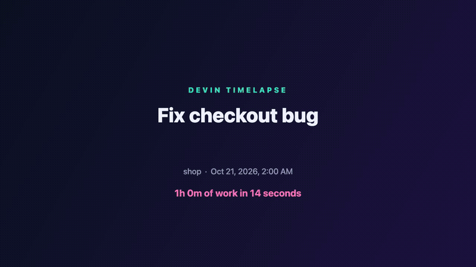
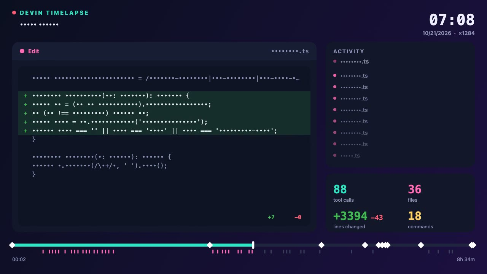

# devin-timelapse

**Turn a Devin session into a 30-second timelapse video.** Your prompts, the commands Devin runs, the diffs it writes,
a fast-forward clock and climbing counters (tool calls, files, lines changed). Made for posting.



```bash
npx github:kaili-yang/devin-timelapse                 # latest session -> devin-timelapse-<id>.mp4
npx github:kaili-yang/devin-timelapse --list          # pick another session
npx github:kaili-yang/devin-timelapse <id> --redact   # safe to post publicly
```

It reads the local session store that **Devin CLI and Devin Desktop** share (`~/.local/share/devin/cli/sessions.db`),
read-only. Nothing is uploaded.

## Output

| File | |
|---|---|
| `.mp4` | 1280×720 H.264, 30 fps (default) |
| `.gif` | `--out clip.gif`, 800 px wide, 12 fps |
| `.html` | always written next to the video: a self-contained player (play / pause / scrub) you can open or host anywhere |

Video export needs **ffmpeg** and **Chrome, Chromium, Edge or Brave** (or `CHROME_PATH`). Without them you still get
the HTML player. A 30 s video renders in about 10 s on an M-series Mac.

## What's in the video

- **Intro**: session title, project, date, "2h 14m of work in 30 seconds"
- **Main stage**, one event at a time:
  your prompts · Devin's messages (typed out) · commands with their output and a FAILED badge on non-zero exit ·
  file edits as a +/− diff · todo lists ticking off · file reads, web searches, subagents and other tools
- **Activity feed** of the latest events, **counters** (tool calls, files, +/− lines, commands), a **timeline** with a
  tick per event and a diamond per prompt, and the **real clock** running at ×speed
- **Outro**: totals

Long sessions are condensed: about 2 events per second get the main stage (prompts first, then edits, commands, …,
spread evenly across the session); counters still include everything. Idle gaps are compressed but still visible
on the clock.

## Options

| | |
|---|---|
| `<session-id>` | default: the most recent session |
| `--list` | recent sessions with ids, age and message count |
| `--seconds <n>` | video length (default 12–30 s by activity) |
| `--out <file>` | `.mp4`, `.gif` or `.html` |
| `--fps <n>` | default 30 |
| `--redact` | replaces prompt text, code, file names and command arguments with `•` (keeps program names and file extensions) |
| `--db <path>` | another session store (or `DEVIN_SESSIONS_DB`) |
| `--no-open` | don't open the result |

> Without `--redact` the video shows your prompts, code and commands. Check it before posting.

<details>
<summary>Redacted frame</summary>


</details>

## How it works

```
sessions.db ─▶ loadSession ─▶ buildTimeline (events on a video clock + running counters)
                                   │
                                   ├─▶ HTML player (canvas, renderFrame(t) is a pure function of t)
                                   └─▶ headless Chrome over --remote-debugging-pipe renders every frame ─▶ ffmpeg ─▶ mp4 / gif
```

Message times come from each message's own `created_at` metadata, because the store rewrites row timestamps when a
session is compacted or reloaded. When Devin compacts a long conversation, older turns survive only as a summary, so
very long sessions may start partway through.

## Development

Node ≥ 22.13 (built-in `node:sqlite`), zero dependencies.

```bash
npm test     # timeline + player (in a VM with a fake canvas); a real mp4 export when Chrome and ffmpeg are present
```

MIT © Kelly Yang
